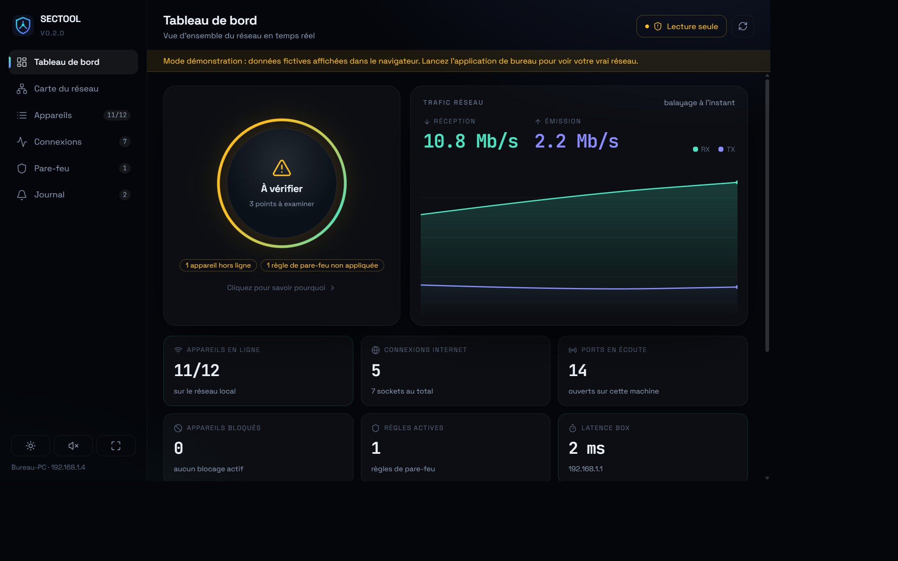
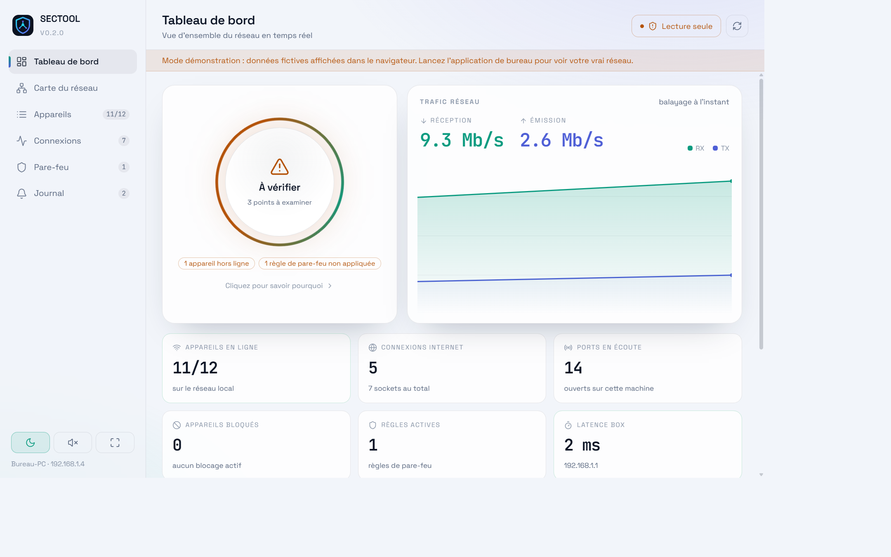
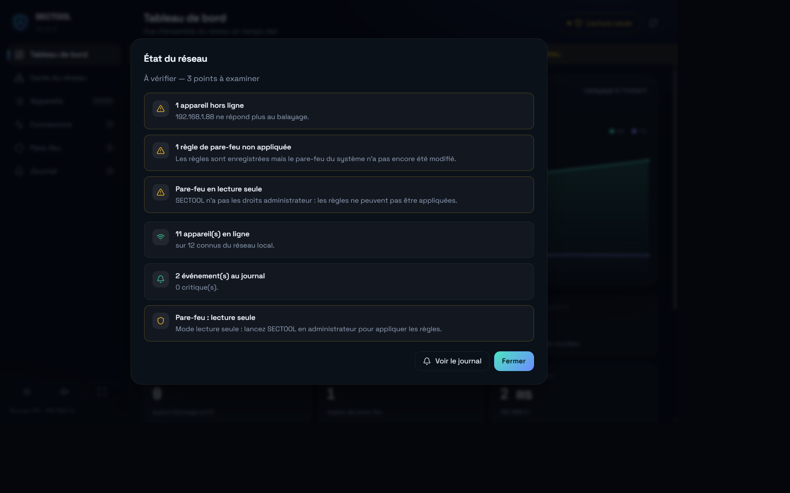
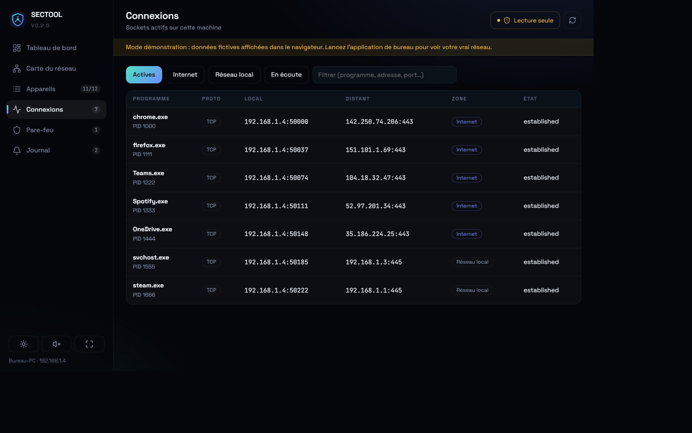

# SECTOOL

[](https://github.com/zigmoon/SECTOOL/actions/workflows/release.yml)
[](https://github.com/zigmoon/SECTOOL/releases/latest)
[](https://github.com/zigmoon/SECTOOL/releases/latest)
[](LICENSE)

**Voir tout son réseau en temps réel, et le contrôler.**
Tableau de bord visuel, appareils du réseau local (box, ordinateurs, téléphones, imprimantes,
télévisions, objets connectés), connexions de la machine, débit instantané — et un petit
**pare-feu logiciel** avec aperçu avant application.

Rust pour le moteur, [Tauri 2](https://tauri.app) pour la fenêtre, [Astro](https://astro.build) + Vite pour l'interface.



## Télécharger

> Toutes les versions : **[github.com/zigmoon/SECTOOL/releases](https://github.com/zigmoon/SECTOOL/releases/latest)**

| Système | Fichier | Téléchargement direct |
|---|---|---|
| **Windows** 10/11 (64 bits) | `SECTOOL_0.2.0_x64-setup.exe` | **[Télécharger](https://github.com/zigmoon/SECTOOL/releases/download/v0.2.0/SECTOOL_0.2.0_x64-setup.exe)** |
| **Windows** 10/11 (64 bits) | `SECTOOL_0.2.0_x64_en-US.msi` | **[Télécharger](https://github.com/zigmoon/SECTOOL/releases/download/v0.2.0/SECTOOL_0.2.0_x64_en-US.msi)** |
| **macOS** 10.15+ (Intel + Apple Silicon) | `SECTOOL_0.2.0_universal.dmg` | **[Télécharger](https://github.com/zigmoon/SECTOOL/releases/download/v0.2.0/SECTOOL_0.2.0_universal.dmg)** |
| **Linux** Debian / Ubuntu | `SECTOOL_0.2.0_amd64.deb` | **[Télécharger](https://github.com/zigmoon/SECTOOL/releases/download/v0.2.0/SECTOOL_0.2.0_amd64.deb)** |
| **Linux** Fedora / openSUSE | `SECTOOL-0.2.0-1.x86_64.rpm` | **[Télécharger](https://github.com/zigmoon/SECTOOL/releases/download/v0.2.0/SECTOOL-0.2.0-1.x86_64.rpm)** |
| **Linux** toutes distributions | `SECTOOL_0.2.0_amd64.AppImage` | **[Télécharger](https://github.com/zigmoon/SECTOOL/releases/download/v0.2.0/SECTOOL_0.2.0_amd64.AppImage)** |

Les trois paquets sont réellement construits par GitHub Actions à chaque tag
(voir [le workflow](https://github.com/zigmoon/SECTOOL/actions/workflows/release.yml)) :
Windows, macOS universel et Linux. Aucune signature commerciale n'est achetée : Windows
SmartScreen et macOS Gatekeeper peuvent afficher un avertissement au premier lancement.

## Le tableau de bord

- **Orbe d'état** : vert quand tout va bien, orange dès qu'un point mérite un regard,
  rouge en cas de problème. Un clic explique **pourquoi** : appareil hors ligne, passerelle
  injoignable, règle de pare-feu non appliquée, alerte critique récente…
- **Débit en direct** : réception et émission, courbe lissée sur les 2 dernières minutes.
- **Six métriques** : appareils en ligne, connexions Internet, ports en écoute, appareils
  bloqués, règles actives, latence de la box.
- **Alertes récentes**, **répartition des appareils** par type et **détail par interface**.

| Thème sombre | Thème clair |
|---|---|
|  |  |

**Un clic sur l'orbe explique chaque point :**



### Alertes sonores

Un **bip** est synthétisé (aucun fichier audio) dès qu'une alerte importante arrive :
deux notes pour un avertissement, trois pour un problème critique. Le bouton haut-parleur
de la barre latérale coupe ou réactive le son, et le réglage est mémorisé.

### Plein écran

Le bouton plein écran (ou **F11**) bascule la fenêtre en immersif. Utile pour garder
la surveillance sur un second écran pendant que vous codez.

## Ce que fait SECTOOL

| Section | Contenu |
|---|---|
| **Tableau de bord** | Orbe d'état cliquable, débit, métriques, alertes, répartition |
| **Carte du réseau** | La box au centre, chaque appareil avec son icône et son statut ; un clic ouvre sa fiche et permet de le bloquer |
| **Appareils** | IP, MAC, constructeur, ports ouverts, latence, recherche, export JSON |
| **Connexions** | Sockets TCP/UDP de la machine : programme, adresse distante, zone, état |
| **Pare-feu** | Règles bloquer/autoriser, aperçu exact des commandes, application, retrait |
| **Journal** | Nouvel appareil, retour en ligne, hors ligne, changement d'adresse MAC |




## Comment il voit le réseau

Aucun pilote, aucune capture de paquets, aucun droit particulier pour l'observation :

1. **Table ARP** du système (les voisins déjà connus).
2. **Réveil ARP** par de petits datagrammes UDP, pour découvrir les appareils silencieux.
3. **Sondes TCP** sur quelques ports courants : présence, latence, services réellement ouverts.
4. **mDNS / Bonjour** : noms conviviaux et modèles annoncés (AirPlay, imprimantes, Chromecast…).
5. **DNS inverse** pour les appareils encore anonymes.

Les adresses MAC sont traduites en constructeur grâce à une table embarquée (box françaises,
Apple, Samsung, Xiaomi, Synology, Raspberry Pi, Espressif, imprimantes…), sans appel réseau.

## Le pare-feu

Le pare-feu est **volontairement prudent** :

- Les règles sont d'abord enregistrées dans `firewall.json` ; elles **ne touchent pas** le système.
- Un bouton **« Aperçu des commandes »** montre exactement ce qui sera exécuté.
- Seul « Appliquer » agit, et l'autorisation du système est demandée à ce moment-là
  (UAC sous Windows, `pkexec`/`sudo` sous Linux, mot de passe macOS).
- Moteurs utilisés : `netsh advfirewall` (Windows), `nftables` table `inet sectool` (Linux),
  ancre `pf` dédiée (macOS).
- SECTOOL ne modifie **jamais** les règles qui ne lui appartiennent pas ; « Tout retirer »
  supprime uniquement les siennes (préfixe `SECTOOL|`).

> Utilisez SECTOOL uniquement sur un réseau qui vous appartient ou que vous administrez.

## Ligne de commande

Le moteur fonctionne aussi sans interface :

```bash
cargo run -p sectool-cli -- scan            # un balayage, tableau des appareils
cargo run -p sectool-cli -- watch           # en boucle, toutes les 5 s
cargo run -p sectool-cli -- scan --json     # sortie JSON
cargo run -p sectool-cli -- connections     # sockets de la machine
cargo run -p sectool-cli -- preview         # commandes de pare-feu, sans agir
cargo run -p sectool-cli -- apply --yes     # applique les règles enregistrées
```

## Développer

Prérequis : Rust stable, Node 20+, et sous Linux `libwebkit2gtk-4.1-dev`.

```bash
npm install
npm --prefix app install

npm run app:dev      # interface seule dans le navigateur (données de démonstration)
npm run dev          # application de bureau complète (Tauri)
npm run build        # installeurs pour la plateforme courante
```

`.github/workflows/release.yml` produit Windows, macOS et Linux à chaque tag `vX.Y.Z`.

## Structure

```
crates/sectool-core       types, règles, table des constructeurs, réglages
crates/sectool-net        ARP, sondes TCP/UDP, mDNS, sockets, débit
crates/sectool-firewall   netsh / nftables / pf, aperçu et application
crates/sectool-cli        commande `sectool`
src-tauri                 application de bureau (Tauri 2)
app                       interface Astro + Vite (mode démonstration sans Tauri)
docs                      captures d'écran
```

## Licence

[AGPL-3.0-or-later](LICENSE). Icônes : [Lucide](https://lucide.dev) (ISC).

Polices embarquées, sous SIL Open Font License 1.1 :
[Space Grotesk](https://fonts.google.com/specimen/Space+Grotesk) et
[JetBrains Mono](https://fonts.google.com/specimen/JetBrains+Mono).
Les textes de licence sont dans `app/public/fonts/`.
